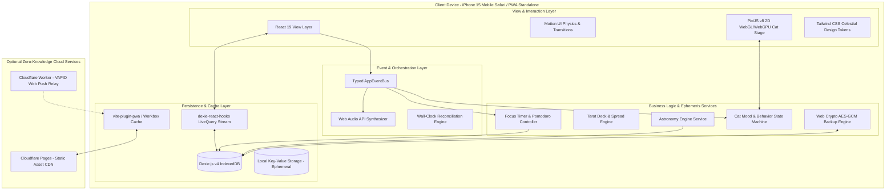

# MoonPaw - Technical Architecture Specification

**Document Version:** 1.0.0  
**Target Platform:** iPhone 15 / iOS Standalone PWA & Modern Evergreen Browsers  
**Author:** Lead Software Architect & Senior TypeScript Engineer  

---

## 1. High-Level Architectural Overview

MoonPaw is engineered as a zero-cloud, client-authoritative Progressive Web App. The browser environment acts as a full-fledged client operating system with persistent local databases, hardware-accelerated 2D graphics rendering, and offline mathematical ephemeris calculation.



---

## 2. Technology Stack & Technical Justifications

| Layer / Technology | Version / Spec | Architecture Rationale & Justification |
| :--- | :--- | :--- |
| **React** | `^19.0.0` | Declarative UI layer, concurrent rendering, and zero-overhead component trees. |
| **TypeScript** | `^5.6.0` (Strict) | Compile-time safety across database schema, event bus contracts, and astronomical calculations. |
| **Vite** | `^6.0.0` | Ultra-fast HMR, ES module bundling, tree-shaking, and seamless PWA service worker generation. |
| **Tailwind CSS** | `^3.4.0` | Utility-first CSS providing granular theme tokens (cosmic gradients, celestial color palettes) and iOS safe-area utilities without runtime CSS-in-JS overhead. |
| **Dexie.js** | `^4.0.0` | Idiomatic, type-safe IndexedDB wrapper providing ACID transactions, reactive `useLiveQuery` hooks, and compound indexing for rapid search. |
| **PixiJS** | `^8.5.0` | Industry-standard WebGL/WebGPU 2D canvas renderer. Handles high-fidelity sprite rendering, procedural skeletal animation, and particle physics at 60fps with low battery drain. |
| **Motion** | `^11.11.0` | Production-grade spring animations and gesture physics for modals, sheets, and card flips. |
| **date-fns** | `^4.1.0` | Tree-shakeable, immutable functional date utilities for calendar arithmetic, recurrence, and time-zone safety. |
| **Astronomy Engine** | `^2.1.0` | Pure mathematical celestial calculations by Don Cross. Computes high-precision moon phases, planetary coordinates, and ecliptic coordinates completely offline. |
| **Recharts** | `^2.13.0` | Declarative SVG-based charting for habit streaks, focus duration metrics, and lunar-mood correlations. |
| **vite-plugin-pwa** | `^0.20.0` | Zero-configuration Workbox integration for generating offline service workers, asset caching, and web app manifests. |
| **Cloudflare Pages** | Edge CDN | Ultra-fast global hosting of static PWA bundles with zero cold starts and instant SSL. |
| **Web Crypto API** | Native W3C | Native browser implementation of PBKDF2 and AES-256-GCM for military-grade encrypted backups with zero external dependencies. |

---

## 3. Directory & Component Hierarchy

```
moonpaw-pwa/
├── docs/                             # Architectural and planning documentation
├── public/                           # Static PWA assets, icons, manifest
│   ├── icons/                        # Apple touch icons, maskable icons, splash screens
│   ├── sounds/                       # Ambient audio and synthesized effects
│   └── favicon.ico
├── images/                           # Source artworks (Tarot, Celestial backgrounds, icons)
│   ├── Background.jpeg
│   ├── Fav1.jpeg
│   ├── Fav2.mp4
│   ├── Tarot 1.jpeg
│   ├── Tarot 2.jpeg
│   └── Tarot 3.jpeg
├── src/
│   ├── assets/                       # Sprites, shaders, and web fonts
│   ├── canvas/                       # PixiJS Canvas Engine & Renderers
│   │   ├── CatStage.tsx              # React-Pixi bridge component
│   │   ├── CatRenderer.ts            # PixiJS Application, Spritesheet & Render loop
│   │   ├── ParticleSystem.ts         # Hearts, stardust, sparkle emitters
│   │   └── CatAnimations.ts          # Animation frame sequences & blend trees
│   ├── components/                   # Shared Reusable UI Components
│   │   ├── common/                   # Buttons, Badges, Modals, Sliders, Toggles
│   │   ├── navigation/               # Celestial Bottom Navigation & Island Header
│   │   ├── layout/                   # AppShell, SafeAreaContainer, CosmicBackground
│   │   └── charts/                   # Recharts wrappers (MoodRadar, FocusBarChart)
│   ├── features/                     # Domain-Driven Feature Modules
│   │   ├── tasks/                    # Task list, task drawer, tag chips, recurrence editor
│   │   ├── calendar/                 # Month grid, day agenda, lunar timeline overlays
│   │   ├── focus/                    # Pomodoro circle, ambient audio player, task binder
│   │   ├── pet/                      # Cat status bars, treat inventory, accessory wardrobe
│   │   ├── lunar/                    # Moon phase visualizer, zodiac badge, ritual guide
│   │   ├── tarot/                    # 3D Card flip component, deck shuffler, spread reader
│   │   ├── journal/                  # Daily reflection form, mood selector, timeline view
│   │   └── settings/                 # Encrypted backup/restore, quiet hours, push toggle
│   ├── db/                           # Dexie.js Schema & Database Services
│   │   ├── database.ts               # Dexie instance & versioned schema definitions
│   │   ├── seed.ts                   # Initial celestial shop items, achievements, tarot cards
│   │   └── queries/                  # Granular database query helpers & transactions
│   ├── events/                       # Typed Event Bus & Global Event Contracts
│   │   ├── AppEventBus.ts            # Pub/Sub singleton for cross-module triggers
│   │   └── events.ts                 # Strongly-typed event payloads
│   ├── hooks/                        # Custom React Hooks
│   │   ├── useCatState.ts            # Reactive connection to cat metrics & state machine
│   │   ├── useLunarPhase.ts          # Reactive astronomy-engine hook with date memoization
│   │   ├── useWallClockTimer.ts      # Drift-free background-safe timer hook
│   │   ├── useAudioEngine.ts         # Web Audio API synthesizers and ambient loopers
│   │   └── useStandalonePWA.ts       # Detects iOS standalone mode and handles install prompts
│   ├── services/                     # Pure Business Logic & External Interfaces
│   │   ├── astronomy.ts              # Astronomy Engine calculations & zodiac mapping
│   │   ├── crypto.ts                 # PBKDF2 key derivation & AES-256-GCM encryption
│   │   ├── audio.ts                  # Web Audio synthesizer for chime/purr generation
│   │   ├── notifications.ts          # Local notifications and Web Push subscription manager
│   │   └── backup.ts                 # JSON serialization, schema validation & checksums
│   ├── state/                        # Transient Global State (Zustand)
│   │   ├── useUIStore.ts             # Active modal, drawer state, theme overrides
│   │   └── useFocusStore.ts          # Running timer session state
│   ├── types/                        # Core TypeScript Interfaces & Contracts
│   │   ├── db.types.ts               # Database entity schemas
│   │   ├── celestial.types.ts        # Lunar & zodiac definitions
│   │   ├── cat.types.ts              # Cat animation & mood enum definitions
│   │   └── tarot.types.ts            # Tarot card metadata & spread structures
│   ├── App.tsx                       # Root routing, layout wrapper & initialization
│   ├── main.tsx                      # Vite React entry point
│   └── index.css                     # Tailwind directives, cosmic gradients & keyframes
├── tailwind.config.js
├── tsconfig.json
├── vite.config.ts
└── package.json
```

---

## 4. State Management & Data Flow Architecture

### 4.1 Persistence Authority: Dexie.js (IndexedDB)
Dexie.js serves as the **single source of truth** for all persistent data. Rather than duplicating persistent records inside Redux or large Zustand stores:
- UI components consume data reactively using `useLiveQuery(() => db.tasks.toArray(), [deps])`.
- When any action writes to Dexie (e.g., `db.tasks.update(id, { status: 'completed' })`), Dexie emits change events internally, causing subscribed React components to re-render automatically.
- This ensures absolute consistency, zero state desynchronization, and zero memory footprint duplication.

### 4.2 Transient Session State: Lightweight Zustand Stores
Transient state that does not need to outlive the active browser session is stored in minimal Zustand stores:
1. `useUIStore`: Active modal sheets, bottom navigation active tab, drawer expansion.
2. `useFocusStore`: Current running timer seconds, pause state, and active session ID.
3. `useAudioStore`: Audio mute toggle, volume sliders, active ambient noise track.

### 4.3 Typed Cross-Cutting Event Bus (`AppEventBus`)
To maintain loose coupling between disparate feature modules, MoonPaw employs a strongly typed Event Bus:

```typescript
// src/events/events.ts
export type AppEvents = {
  'task:completed': { taskId: string; priority: string; stardustEarned: number };
  'focus:started': { sessionId: string; taskId?: string };
  'focus:completed': { sessionId: string; minutes: number; stardustEarned: number };
  'cat:fed': { treatType: string; hungerRestored: number };
  'cat:petted': { intensity: number };
  'tarot:drawn': { cardId: string; spreadType: string };
  'journal:saved': { entryId: string; moodScore: number };
  'lunar:phase_changed': { newPhase: string; moonSign: string };
};
```

**Decoupled Workflow Example:**
1. User clicks "Complete" on a high-priority task in the `TaskList` component.
2. `db.tasks.update(taskId, { status: 'completed', completedAt: new Date() })` writes to IndexedDB.
3. `AppEventBus.emit('task:completed', { taskId, priority: 'Supernova', stardustEarned: 50 })` fires.
4. The `CatStage` subscriber catches the event and triggers the `CELEBRATING` animation and spawns stardust particles.
5. The `AudioEngine` subscriber catches the event and synthesizes a soft celestial chime.
6. The `EconomyService` updates the cat profile's Stardust balance in IndexedDB.

---

## 5. Rendering Pipeline & Performance Optimization

### 5.1 PixiJS Canvas Isolation
The PixiJS canvas for the celestial cat companion requires careful isolation to prevent CPU/GPU thrashing on mobile devices:
- **Zero React DOM Coupling:** The PixiJS application instance is mounted once via an imperative `useRef` inside `CatStage.tsx`. React never directly re-renders canvas children.
- **Render Loop Throttling:** When the cat enters the `SLEEPING` state or when the app is idle, the Pixi ticker framerate is reduced from 60fps to 15fps or paused entirely, waking up only on user touch gestures.
- **Automatic Asset Scaling:** Spritesheets are loaded with mipmapping and scaled according to `window.devicePixelRatio` (capped at 2.0 to conserve GPU memory on iPhone 15 Retina displays).

### 5.2 CSS Hardware Acceleration & Containment
- All celestial background starfields and drifting nebulas utilize CSS `transform: translate3d(0, 0, 0)` and `will-change: transform` to force GPU compositing layers.
- Complex scroll lists (e.g., Task History, Calendar Month Grid) leverage CSS `contain: content` to isolate layout recalculations.

### 5.3 iOS Background Wall-Clock Reconciliation
Mobile Safari suspends JavaScript execution almost immediately when the screen is locked or the user switches apps. A traditional `setInterval` countdown will freeze and report incorrect elapsed time upon returning.

**Reconciliation Engine:**
```typescript
// Wall-Clock Reconciliation Pattern
class WallClockTimer {
  private startTime: number = 0;
  private targetDurationMs: number = 0;

  start(durationMinutes: number) {
    this.startTime = Date.now();
    this.targetDurationMs = durationMinutes * 60 * 1000;
  }

  getRemainingMs(): number {
    const elapsed = Date.now() - this.startTime;
    return Math.max(0, this.targetDurationMs - elapsed);
  }
}
```
When `document.addEventListener('visibilitychange')` fires on iOS wake:
1. The app computes elapsed time from the real wall-clock timestamp.
2. If elapsed time exceeded the target duration while the phone was locked, the timer automatically transitions to "Completed", plays the completion chime, awards the reward points, and displays the celebratory dialog.

---

## 6. Service Worker Caching & Offline Topology

Powered by `vite-plugin-pwa` with Workbox strategies:

```typescript
// Workbox Cache Strategy Configuration
export const pwaOptions = {
  registerType: 'autoUpdate',
  workbox: {
    globPatterns: ['**/*.{js,css,html,ico,png,svg,jpeg,jpg,mp4,woff2}'],
    runtimeCaching: [
      {
        urlPattern: ({ request }) => request.destination === 'image',
        handler: 'CacheFirst',
        options: {
          cacheName: 'moonpaw-images',
          expiration: { maxEntries: 100, maxAgeSeconds: 60 * 60 * 24 * 90 } // 90 days
        }
      },
      {
        urlPattern: ({ request }) => request.destination === 'audio',
        handler: 'CacheFirst',
        options: {
          cacheName: 'moonpaw-audio',
          expiration: { maxEntries: 30, maxAgeSeconds: 60 * 60 * 24 * 90 }
        }
      }
    ]
  }
};
```
- **100% Offline Resilience:** All core code, stylesheets, astronomical ephemeris algorithms, and graphics are bundled locally. Once loaded, MoonPaw functions indefinitely with zero internet connectivity.
