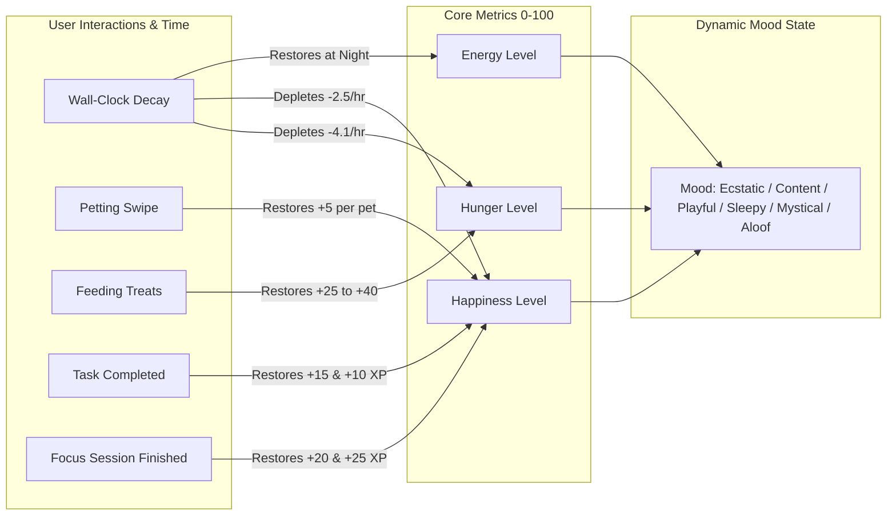
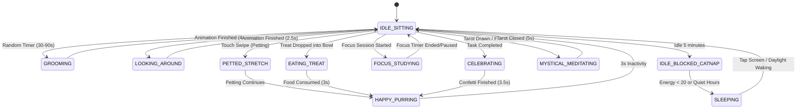

# MoonPaw - Virtual Cat Companion ("Luna") Behavior & Game Engine

**Document Version:** 1.0.0  
**Engine:** PixiJS v8 / WebGL 2D Canvas  
**Design Paradigm:** Cozy Tamagotchi / Emotion-First Companion / Zero-Punitive Mechanics  

---

## 1. Companion Philosophy & Character Design

**Luna** is a celestial cat companion existing in harmony with the user's daily rhythms. Unlike traditional stress-inducing virtual pets that penalize or guilt-trip users for being away, Luna embodies unconditional warmth and gentle encouragement:
- **No Death or Abandonment:** Luna cannot starve, run away, or suffer permanent negative consequences.
- **Gentle State Modulation:** If neglected, Luna simply curls up into a peaceful sleep, waiting patiently for the user to return.
- **Symbiotic Productivity:** Luna reflects the user's focus and accomplishments. When the user works, Luna studies alongside them; when tasks are completed, Luna celebrates with celestial joy.

---

## 2. Emotional & Physical Metrics Engine

Luna's internal state is governed by three continuous metrics (0 to 100) that update based on elapsed wall-clock time and user interactions:



### 2.1 Decay & Replenishment Rates
| Metric | Natural Rate | Replenishment Trigger | Visual Impact |
| :--- | :--- | :--- | :--- |
| **Hunger** | Decays by ~4.16% per hour (100% to 0% over 24 hrs). | Feeding Tuna Can (+35) or Cosmic Fish (+50). | $< 25$: Luna sits by bowl; $\ge 75$: Energetic, purring. |
| **Happiness** | Decays by ~2.5% per hour. | Petting gesture (+5, max 3/min), completing tasks (+15), finishing focus sessions (+20). | $\ge 80$: Ecstatic, purring, spawning star particles; $< 30$: Aloof, resting. |
| **Energy** | Depletes by ~5% per active hour; recovers by ~10%/hr during designated sleep hours (10 PM – 8 AM). | Natural night hours or user toggles "Bedtime Mode". | $< 20$: Curls up into deep slumber (`SLEEPING`). |

---

## 3. Cat Behavior State Machine



### 3.1 State Catalog & Animation Choreography

1. **`IDLE_SITTING` (Default State):**
   - Luna sits upright, chest gently breathing with sinusoidal sprite scaling, tail swaying in a tranquil curve.
   - Ears twitch periodically (every 8–15 seconds).
2. **`PETTED_STRETCH` & `HAPPY_PURRING`:**
   - Triggered by continuous multi-point touch swipes across Luna's back.
   - Luna arches her back into a contented stretch, closes her eyes into happy crescent arcs, and emits purr rings.
   - Spawns floating heart and stardust particle emitters.
3. **`FOCUS_STUDYING` (Co-Working State):**
   - Triggered when the user starts a Focus Timer.
   - Luna puts on miniature celestial reading glasses, curls up comfortably beside an ancient glowing grimoire and a softly flickering candle, nodding in unison with the timer.
4. **`EATING_TREAT`:**
   - User drags a treat from the inventory drawer and drops it on the feeding plate.
   - Luna happily approaches the bowl, chomps down the treat with little heart particles, and licks her whiskers.
5. **`MYSTICAL_MEDITATING`:**
   - Triggered during the Daily Tarot card reveal or during the exact hour of a Full/New Moon.
   - Luna hovers 10px off the rug in a seated lotus-like position, surrounded by glowing orbital constellations and moon rings.
6. **`CELEBRATING`:**
   - Triggered on `task:completed` event.
   - Luna performs a joyful backflip/pounce, meows cheerfully, and showers the screen with golden stardust confetti.
7. **`SLEEPING`:**
   - Luna curls into a donut shape on her cosmic velvet cushion.
   - Gentle floating "Zzz" starlight runes drift upward. Ticker framerate drops to 15fps to conserve iPhone battery.

---

## 4. PixiJS Rendering Pipeline & Texture Atlas

### 4.1 Spritesheet Architecture
The cat rendering pipeline utilizes a packed JSON spritesheet (`luna_atlas.json`):
- **Base Body Frames:** 8-direction idle breathing loop (4 frames, ping-pong).
- **Facial Features:** Blink, smile, curious wink, sleeping eyes.
- **Tail Frames:** 6-frame smooth sinusoidal wave animation.
- **Accessories Layer:** Rendered as child PixiJS `Sprite` or `Container` pinned to socket points (head socket, collar socket, rug layer).

```
CatStage (Pixi Container)
├── RugBackground (Sprite - Z-Index: 0)
├── BowlContainer (Container - Z-Index: 10)
├── CatContainer (Container - Z-Index: 20)
│   ├── BodySprite (AnimatedSprite)
│   ├── HeadContainer
│   │   ├── HeadSprite (Sprite)
│   │   ├── EyeSprite (AnimatedSprite)
│   │   └── HeadAccessory (Sprite - Wizard Hat / Crown)
│   ├── CollarAccessory (Sprite - Celestial Bell)
│   └── TailSprite (AnimatedSprite)
├── ParticleEmitterContainer (Z-Index: 30)
└── FloatingAccessoryContainer (Z-Index: 40 - Floating Planet / Moon)
```

### 4.2 Touch Physics & Gesture Recognition
Mobile touch interaction on iPhone 15 utilizes PixiJS v8's `EventSystem`:
- **Petting Detector:** Listens to `pointermove` within Luna's bounding box. Computes movement velocity vector $\vec{v} = (\Delta x, \Delta y) / \Delta t$. If velocity exceeds threshold ($150 \text{ px/s}$), pet counter increments and purr particles trigger.
- **Tap Detector:** `pointertap` on head socket triggers curious tilt and soft chirp audio.

---

## 5. Web Audio API Sound & Sensory Feedback

To bypass iOS WebKit autoplay restrictions, MoonPaw uses a singleton `AudioEngine`:
- **Audio Context Unlock:** Initialized and resumed on the user's very first touch interaction (`touchstart`).
- **Synthesized Sound Effects (Zero External Audio File Latency):**
  - **Purr Resonance:** Low-frequency dual sine wave oscillator (75Hz & 150Hz) with gentle lowpass filter and rhythmic LFO amplitude modulation (2Hz) generating a soothing physical purr.
  - **Celestial Chime:** Dual triangle oscillators (880Hz & 1760Hz) with quick exponential gain decay simulating a meditation bell.
  - **Meow Chirp:** Pitch-bent frequency sweep (600Hz to 950Hz) with short envelope.
- **Quiet Hours Adherence:** If `isQuietHours()` returns true, all audio nodes are clamped to gain `0.0`.

---

## 6. Gamification, Leveling & Stardust Rewards

### 6.1 Stardust ($\bigstar$) Economy
| Action | Stardust Earned | Experience (XP) |
| :--- | :---: | :---: |
| Complete Starlight Task (Low) | $+10 \bigstar$ | $+15 \text{ XP}$ |
| Complete Moonlight Task (Medium) | $+20 \bigstar$ | $+30 \text{ XP}$ |
| Complete Solar Task (High) | $+35 \bigstar$ | $+50 \text{ XP}$ |
| Complete Supernova Task (Urgent) | $+50 \bigstar$ | $+75 \text{ XP}$ |
| Focus Session (per 25m Pomodoro) | $+25 \bigstar$ | $+50 \text{ XP}$ |
| Daily Tarot Draw & Reflection | $+15 \bigstar$ | $+20 \text{ XP}$ |
| Daily Mood Journal Entry | $+20 \bigstar$ | $+30 \text{ XP}$ |

### 6.2 Level Progression Curve
Luna's companionship level advances according to a smooth non-punitive polynomial curve:
$$\text{XP Required for Level } L = 100 \times L^{1.5}$$

- **Level 1 $\rightarrow$ 2:** $100 \text{ XP}$ (Achieved on Day 1 by completing initial setup).
- **Level 5:** Unlocks *Celestial Wizard Hat* accessory.
- **Level 10:** Unlocks *Astral Rug of the Zodiac*.
- **Level 20:** Unlocks *Aurora Halo* particle aura.
