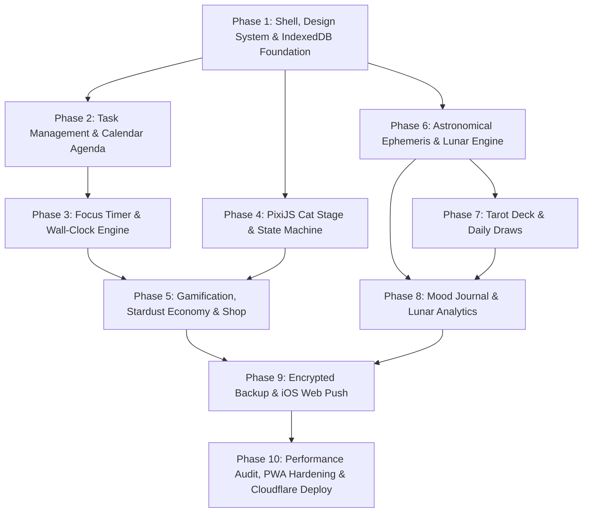

# MoonPaw - Feature Implementation Roadmap

**Document Version:** 1.0.0  
**Target Architecture:** React 19 / TypeScript / Dexie.js / PixiJS / PWA  
**Execution Strategy:** 10 Phased Iterations (From Solid Core to Celestial Polish)  

---

## 1. Phased Dependency Graph

---

## 2. Detailed Phase Breakdown & Milestones

### Phase 1: Foundation, Celestial Design System, PWA Shell & IndexedDB
- **Objective:** Establish rock-solid project structure, offline IndexedDB schema, and responsive celestial UI framework.
- **Key Deliverables:**
  - Vite + React 19 + TypeScript strict configuration.
  - Tailwind CSS configuration with custom cosmic palette (`midnight-950`, `twilight-800`, `starlight-gold`, `moon-silver`, `aurora-cyan`) and iPhone 15 safe area insets.
  - Dexie.js database instance initialization (`MoonPawDatabase`) with Version 1 schema and reactive hooks.
  - App Shell layout with Dynamic Island header, cosmic backdrop, and sticky bottom navigation.
  - Service Worker configuration with `vite-plugin-pwa` and offline cache manifest.
- **Exit Criteria:** App boots instantly offline in iOS Safari, respects safe-area padding, and reads/writes sample data in IndexedDB.

### Phase 2: Tasks, Subtasks, Recurrence & Calendar Integration
- **Objective:** Build the core task productivity engine and unified calendar view.
- **Key Deliverables:**
  - Full CRUD task operations with subtasks, markdown notes, tags, and priorities.
  - Recurrence engine (Daily, Weekly, Monthly, Lunar-aligned).
  - Task drawer and filter views (Today, Upcoming, Completed Archive).
  - Calendar module: Interactive Month, Week, and Day views displaying scheduled tasks and time blocks.
  - Soft-delete and historical archive retention (completed tasks never lost).
- **Exit Criteria:** Creating, editing, recurring, and archiving tasks works seamlessly; tasks render accurately across calendar views.

### Phase 3: Focus Timer Engine & Background Wall-Clock Sync
- **Objective:** Implement the deep-work focus timer with iOS-resilient time tracking.
- **Key Deliverables:**
  - Pomodoro timer (25/5/15), open-ended Stopwatch, and Sprint modes.
  - Wall-clock epoch reconciliation algorithm ensuring zero time drift when iOS screen sleeps.
  - Direct task binding: Track actual minutes spent against active task estimations.
  - Web Audio API synthesizer for ambient noise generation (white noise, rain, celestial hum) and completion bells.
- **Exit Criteria:** Starting a 25-minute timer, locking the iPhone for 10 minutes, and unlocking shows exactly 15 minutes remaining without drift.

### Phase 4: PixiJS Celestial Cat Companion & Animation State Machine
- **Objective:** Bring "Luna" the celestial cat to life with smooth WebGL rendering and interactive touch responses.
- **Key Deliverables:**
  - PixiJS v8 integration within a lightweight React canvas container.
  - Cat behavior state machine (`IDLE_SITTING`, `SLEEPING`, `GROOMING`, `FOCUS_STUDYING`, `PETTED`, `EATING`, `CELEBRATING`).
  - Interactive touch physics: Petting swipe detection, gentle ear taps, purr particle emitters.
  - Emotional metric engine: Hunger, Happiness, and Energy with gentle time-based decay.
- **Exit Criteria:** Cat renders at 60fps on iPhone 15; user swipe petting triggers purr particle emitters and happiness increases.

### Phase 5: Gamification, Stardust Economy, Treats & Accessory Closet
- **Objective:** Connect real-world productivity to companion flourishing.
- **Key Deliverables:**
  - Stardust ($\bigstar$) reward calculation engine tied to task completion and focus minutes.
  - Celestial Moon Shop: Purchase tuna cans, starlight treats, celestial collars, hats, and room carpets.
  - Wardrobe inventory management: Equip and unequip accessories onto the PixiJS cat sprite.
  - 30+ Celestial Milestones and badge showcase screen.
- **Exit Criteria:** Completing a task awards stardust; user can buy a treat from the shop and feed it to the cat in real time.

### Phase 6: Celestial Engine (Astronomy Engine Offline Ephemeris)
- **Objective:** Calculate exact astronomical moon data and astrological signs without internet.
- **Key Deliverables:**
  - `astronomy-engine` service wrapper computing exact moon phase, illumination %, moon age, and ecliptic coordinates.
  - Real-time Zodiac Moon Sign mapping (Aries through Pisces) with interpretive psychological guidance.
  - Void-of-Course moon calculation and notification badges.
  - Moon phase widget on home screen with glowing SVG/WebGL luminescence rendering.
- **Exit Criteria:** Mathematical verification matching US Naval Observatory ephemeris data for current date/time to within 0.1% accuracy completely offline.

### Phase 7: Mystical Tarot Deck & Guided Daily Reflections
- **Objective:** Introduce introspective mindfulness with interactive celestial tarot.
- **Key Deliverables:**
  - Complete 78-card celestial deck schema with upright/reversed interpretations and reflective keywords.
  - 3D card flip animation component with realistic spring physics.
  - Daily 1-Card Draw and 3-Card Spread (Past / Present / Future) modes.
  - Deep-link action to seamlessly transfer the drawn card's prompt into the Mood Journal.
- **Exit Criteria:** User draws a card with smooth flipping animation; drawn card is preserved in the daily draw history table.

### Phase 8: Private Mood Journal & Lunar Correlation Analytics
- **Objective:** Provide a private sanctuary for journaling with automated celestial correlation graphs.
- **Key Deliverables:**
  - Daily mood logger (1–5 celestial scale), emotion tag selector, and markdown reflection editor.
  - Recharts integration: Interactive mood-over-time graphs and correlation radar charts mapping moods against lunar phases.
  - Historical journal search and calendar timeline view.
- **Exit Criteria:** User records journal entries over multiple days; analytics dashboard highlights mood trends alongside moon phases.

### Phase 9: Encrypted Backup/Restore, iOS Web Push & Audio Hardening
- **Objective:** Implement data sovereignty, military-grade client cryptography, and optional push notifications.
- **Key Deliverables:**
  - Client-side Web Crypto API pipeline: PBKDF2 key derivation (600,000 iterations) and AES-256-GCM encryption/decryption.
  - JSON backup file exporter (`.moonpaw` bundle with integrity checksum) and importer with decryption validation.
  - Strict quiet hours configuration (10 PM – 8 AM default).
  - Optional Cloudflare Worker relay for VAPID Web Push notifications for standalone iOS PWAs.
- **Exit Criteria:** User exports password-encrypted backup, deletes local database, and successfully restores all tasks, journal entries, and cat stats.

### Phase 10: Performance Optimization, A11y, PWA Polish & Cloudflare Deployment
- **Objective:** Final optimization, accessibility compliance, and production edge deployment.
- **Key Deliverables:**
  - Lighthouse performance audit targeting 100/100 PWA, Best Practices, and Accessibility scores.
  - WCAG 2.1 AA contrast checks and `prefers-reduced-motion` fallbacks across PixiJS and Motion.
  - Apple touch icons, maskable icons, and splash screen generator matching iPhone 15 resolutions.
  - Cloudflare Pages automated deployment configuration (`wrangler.toml` or git integration).
- **Exit Criteria:** App achieves 60fps on iPhone 15, installs cleanly to Home Screen, passes full automated test suite, and deploys to production CDN.

---

## 3. Feature Matrix: MVP vs. Post-MVP Scope

| Feature Capability | MVP Release (Phases 1–9) | Post-MVP Expansion (v1.1+) |
| :--- | :---: | :---: |
| Offline Task & Subtask Management | ✅ Included | Subtask drag-and-drop reordering |
| Recurrence Engine (Daily, Weekly, Monthly) | ✅ Included | Complex custom cron recurrence |
| Lunar Phase & Moon Sign Calculations | ✅ Included | Full planetary birth chart calculator |
| Pomodoro & Stopwatch Focus Timers | ✅ Included | Collaborative focus rooms (P2P WebRTC) |
| PixiJS Interactive Cat (Petting, Feeding, Moods) | ✅ Included | Multiple cat breeds & kitten adoption |
| Cat Accessory Wardrobe & Shop | ✅ Included | Room furniture custom positioning |
| Daily 1-Card & 3-Card Tarot Draws | ✅ Included | Custom user-uploaded tarot deck art |
| Private Encrypted Mood Journal | ✅ Included | Audio voice-note recordings (local WebM) |
| AES-256-GCM Encrypted File Backup/Restore | ✅ Included | Encrypted P2P QR-code sync between devices |
| Standalone iOS PWA Installation & Offline Mode | ✅ Included | Native Capacitor iOS app wrapper |
| Optional Web Push via Cloudflare Worker | ✅ Included | Rich push with quick-action buttons |
