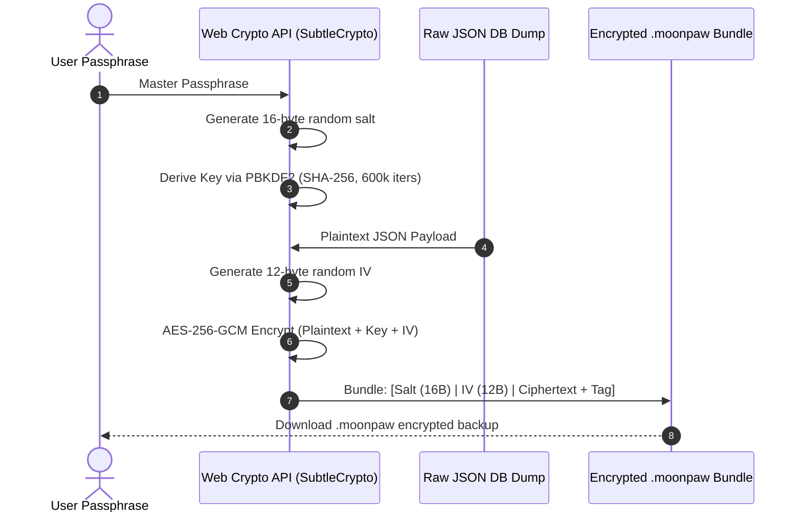

# MoonPaw - Security Architecture & Privacy Specification

**Document Version:** 1.0.0  
**Security Model:** Zero-Knowledge, Zero-Cloud, Client-Authoritative  
**Cryptography Standard:** Web Crypto API (PBKDF2-HMAC-SHA256 & AES-256-GCM)  

---

## 1. Zero-Cloud Privacy Guarantee

MoonPaw is built on an uncompromising privacy foundation:
1. **No Central Database:** There is no centralized database, user directory, or authentication server storing user identities, task lists, calendar events, or journal entries.
2. **Zero Commercial Telemetry:** The application bundles zero marketing analytics, zero third-party trackers (no Google Analytics, Facebook Pixel, Mixpanel, or Hotjar), and zero crash reporting agents that phone home with private data payloads.
3. **Data Sovereignty:** All personal thoughts, to-dos, tarot reflections, and pet interactions are stored strictly on the local device in HTML5 IndexedDB, encrypted at rest when exported.

---

## 2. STRIDE Threat Model (Client-Side PWA)

| Threat Category | Potential Attack Vector | MoonPaw Security Countermeasure |
| :--- | :--- | :--- |
| **Spoofing** | Attacker impersonating the app or injecting fake updates. | Strict TLS/HTTPS enforced by Cloudflare Pages; PWA service worker verifies package hashes before updating. |
| **Tampering** | Modification of local IndexedDB data or corrupted backup files. | Authenticated encryption with AES-256-GCM ensures any tampered ciphertext byte fails auth tag validation, preventing injection of malicious payloads. |
| **Repudiation** | Disputes over task completion or data integrity. | All mutations are timestamped with monotonic UTC ISO strings and stored locally in the immutable `taskHistory` log. |
| **Information Disclosure** | Device theft, unauthorized physical access, or backup extraction. | Client-side PBKDF2 + AES-256-GCM export encryption; sensitive journal entries can be protected behind an in-app biometric/passcode gate. |
| **Denial of Service** | Safari 7-day IndexedDB eviction or browser storage quota exhaustion. | Proactive `navigator.storage.persist()` registration; storage quota monitoring via `navigator.storage.estimate()`. |
| **Elevation of Privilege** | Malicious third-party scripts executing in DOM (XSS). | Strict Content Security Policy (CSP), zero external CDN script tags, no `eval()`, sanitized markdown rendering. |

---

## 3. Cryptographic Specification & Implementation

### 3.1 Key Derivation Function (PBKDF2)
When the user creates an encrypted backup or enables client-side database locking, their passphrase is transformed into an AES-256 key using PBKDF2:

```typescript
// Key Derivation Parameters
export const CRYPTO_PARAMS = {
  name: 'PBKDF2',
  hash: 'SHA-256',
  iterations: 600000, // OWASP recommended iteration baseline for PBKDF2-HMAC-SHA256
  saltLength: 16 // 128-bit cryptographically secure random salt
};
```

### 3.2 Authenticated Encryption (AES-256-GCM)
Backups are encrypted using AES-GCM (Galois/Counter Mode), which provides both confidentiality and data authenticity:
- **Cipher:** AES-GCM
- **Key Length:** 256 bits (32 bytes)
- **Initialization Vector (IV):** 96 bits (12 bytes), generated freshly for every export operation via `crypto.getRandomValues(new Uint8Array(12))`. **IVs are never reused.**
- **Authentication Tag:** 128 bits (16 bytes), verified before ciphertext decryption begins.



### 3.3 Decryption Verification
When importing an encrypted `.moonpaw` backup file:
1. The app extracts the 16-byte Salt and 12-byte IV from the header.
2. Derives the AES key using the user-provided passphrase and Salt.
3. Attempts decryption with `crypto.subtle.decrypt()`.
4. If the passphrase is incorrect or the ciphertext was altered by a single bit, the GCM authentication tag verification throws an `OperationError`.
5. The transaction aborts immediately without touching or corrupting the existing IndexedDB tables.

---

## 4. Separation of Technical Operations vs. User Data

To preserve complete privacy while maintaining operational maintainability:

### 4.1 Strict Isolation Principles
- **No Hidden Admin Portals:** There are no administrative endpoints or master backdoors. Not even the software creator can unlock or inspect a user's data.
- **Client-Side Redacted Diagnostic Logs:**
  If the user encounters a technical defect and requests support, they can navigate to **Settings $\rightarrow$ Diagnostics** and generate a diagnostic report.
  The diagnostic generator executes strict local sanitization before export:

```typescript
// Sanitization Pipeline Example
export function sanitizeDiagnostics(rawState: AppState): DiagnosticReport {
  return {
    appVersion: '1.0.0',
    userAgent: navigator.userAgent,
    storageQuota: await navigator.storage.estimate(),
    pwaStandalone: window.matchMedia('(display-mode: standalone)').matches,
    tableCounts: {
      tasks: await db.tasks.count(),
      events: await db.calendarEvents.count(),
      journalEntries: await db.journalEntries.count()
    },
    // SENSITIVE STRINGS ARE STRICTLY SCRUBBED:
    recentErrors: errorLogger.getRecentErrors().map(err => ({
      message: err.message.replace(/([A-Z0-9._%+-]+@[A-Z0-9.-]+\.[A-Z]{2,})/gi, '[EMAIL_REDACTED]'),
      stack: err.stack
    }))
  };
}
```
*Notice:* Zero task titles, zero journal notes, zero calendar event descriptions, and zero user secrets are ever included in diagnostic bundles.

---

## 5. iOS Safari Data Eviction Defense & Quota Resilience

Mobile Safari enforces aggressive cache eviction rules for non-installed websites (WebKit ITP 7-day storage caps). MoonPaw implements a multi-tiered data defense:

1. **Persistent Storage Request:**  
   On application launch, MoonPaw requests permanent persistence:
   ```typescript
   if (navigator.storage && navigator.storage.persist) {
     const isPersisted = await navigator.storage.persist();
     console.info(`IndexedDB Persistence Granted: ${isPersisted}`);
   }
   ```
2. **PWA Standalone Encouragement:**  
   When running inside regular Safari browser tabs, MoonPaw gently reminds the user that adding MoonPaw to the iOS Home Screen promotes its storage from ephemeral browser cache to a sandboxed, permanent iOS application container.
3. **Backup Reminders:**  
   If the user has not created an encrypted backup within 30 days, MoonPaw gently displays a celestial starlight reminder encouraging an export.

---

## 6. Content Security Policy (CSP)

The production Cloudflare Pages deployment serves strict security headers via `_headers`:

```http
Content-Security-Policy: default-src 'self'; script-src 'self' 'wasm-unsafe-eval'; style-src 'self' 'unsafe-inline' https://fonts.googleapis.com; font-src 'self' https://fonts.gstatic.com; img-src 'self' data: blob:; media-src 'self' data: blob:; connect-src 'self'; worker-src 'self' blob:; frame-ancestors 'none'; base-uri 'self'; form-action 'self';
X-Frame-Options: DENY
X-Content-Type-Options: nosniff
Referrer-Policy: strict-origin-when-cross-origin
Permissions-Policy: geolocation=(), camera=(), microphone=(), payment=()
```

- Blocks any third-party external scripts from executing.
- Disables access to camera, microphone, and geolocation hardware.
- Allows WebAssembly for high-performance cryptographic operations.
